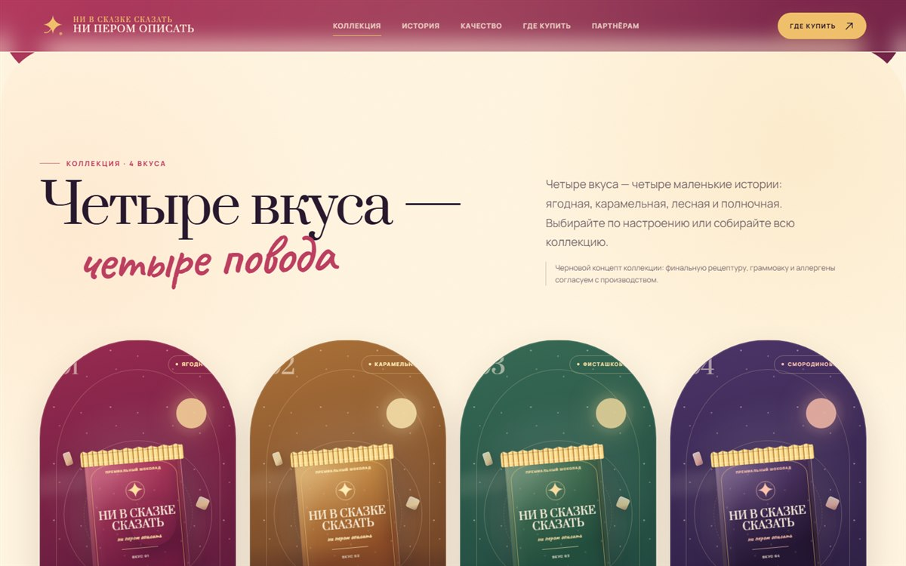
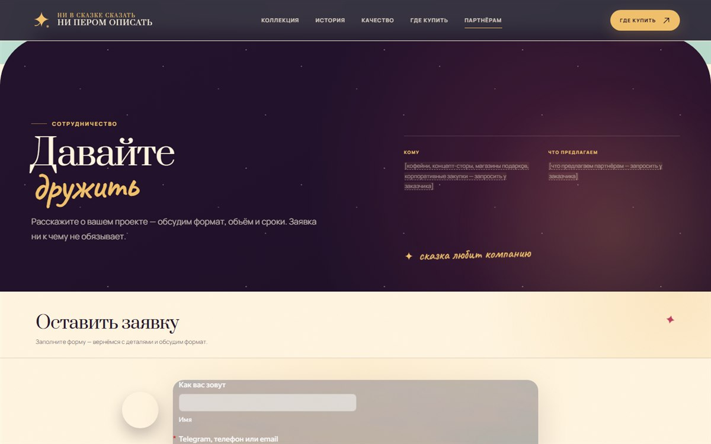

# «НИ В сказке сказать, НИ ПЕРОМ описать» — лендинг премиального шоколада

Одностраничный статический сайт в сказочной иллюстрированной стилистике: облака-занавес на первом экране, авторские SVG-иллюстрации, четыре вкуса с анимированными упаковками и Яндекс Форма для заявок на сотрудничество.

**Живой сайт:** <https://www.niperom.ru/> · Чистый HTML/CSS/JS, без сборщика и фреймворков.


## Задача

Заказчику нужен был премиальный одностраничный лендинг для крафтового шоколада «НИ В сказке сказать, НИ ПЕРОМ описать»:

- представить бренд как сказку — единый иллюстрированный мир, а не набор блоков с текстом;
- показать коллекцию из четырёх вкусов крупными изображениями, без корзины и онлайн-оплаты;
- собрать заявки на сотрудничество и корпоративные закупки через готовую Яндекс Форму;
- сайт должен быстро загружаться, корректно работать на телефонах, хорошо индексироваться и легко редактироваться без программиста.

## Пользователи

| Кто | Что ищет на сайте |
| --- | --- |
| Покупатели на маркетплейсах | Вкусы, состав, ссылки на Wildberries / Ozon / Яндекс Маркет |
| Ищущие необычный подарок | Поводы и кейсы, отзывы, «где купить» |
| Оптовые и корпоративные заказчики | Условия сотрудничества, форма заявки |
| Потенциальные партнёры (магазины, кофейни) | Философию бренда, контакты, условия |

## Что сделано



- **Структура:** первый экран → боли → решения → коллекция → история → качество → где купить → отзывы → поводы → сотрудничество → контакты.
- **Первый экран:** облака медленно расходятся как театральный занавес, открывая замок, дорогу, лису и плитку. Анимация ничего не блокирует — контент и навигация доступны сразу.
- **Коллекция:** четыре вкуса («Румяный рассвет», «Карамельный замок», «Изумрудная тропа», «Полночное перо»). Упаковка собрана на HTML/CSS и перекрашивается темами, без отдельных картинок. При появлении плитка «всплывает», при наведении карточка приподнимается и проходит блик, кольцо, луна и облака в карточках двигаются.
- **Лиса-проводник** сопровождает посетителя по странице, реплики меняются по разделам.
- **Яндекс Форма** встроена в блок «Сотрудничество» и занимает всю ширину окна на десктопе и телефоне; высота iframe адаптируется автоматически.
- **Адаптивность** от 320 до 1440 px, мобильное меню, scroll-reveal и scroll-spy.
- **SEO:** мета-теги, Open Graph, JSON-LD (`WebPage`, `Brand`), `robots.txt`, `sitemap.xml`, canonical.
- **Аналитика-ready:** настройки Яндекс Метрики и GA4 в одном месте, события кликов по кнопкам, вкусам и маркетплейсам.
- **Доступность:** Lighthouse 100 по Accessibility, Best Practices и SEO; клавиатурная навигация; все анимации отключаются при `prefers-reduced-motion: reduce`.



## Технологии

- HTML5, CSS3, ванильный JavaScript — без сборки, зависимостей и фреймворков.
- Все иллюстрации — собственные SVG, масштабируются без потери качества.
- Заявки — встраиваемая Яндекс Форма; Google Таблицы и серверный код не используются.
- Локальный предпросмотр — PowerShell-скрипт `serve.ps1` или любой статический сервер.

## Структура проекта

```text
niperom-landing/
├── index.html          разметка, SEO-мета, JSON-LD, встроенная Яндекс Форма
├── css/styles.css      все стили, адаптивность, анимации
├── js/content.js       тексты, ссылки, контакты, отзывы, настройки
├── js/main.js          рендер, меню, аналитика, лиса-проводник
├── assets/             SVG-иллюстрации и og-cover.png
├── screenshots/        скриншоты для этого README
├── serve.ps1           локальный сервер для предпросмотра (Windows)
├── start-site.bat      запуск сервера двойным щелчком
├── robots.txt          правила индексации
├── sitemap.xml         карта сайта
└── README.md           эта инструкция
```

## Быстрый запуск

Открывать `index.html` двойным кликом нежелательно: браузер ограничивает часть возможностей на `file://`. Запустите локальный сервер.

### Windows — одним щелчком

Дважды щёлкните `start-site.bat` в папке проекта. Откроется браузер с адресом <http://127.0.0.1:8765/>. Окно PowerShell оставьте открытым: пока оно работает, сайт доступен. Чтобы остановить сервер, закройте окно или нажмите `Ctrl+C`.

### Через PowerShell

```powershell
powershell -NoProfile -ExecutionPolicy Bypass -File .\serve.ps1
```

### Через Python

```powershell
python -m http.server 8765
```

Затем откройте <http://127.0.0.1:8765/>. Если команда `python` открывает Microsoft Store, значит Python не установлен — используйте `start-site.bat` или `serve.ps1`. Подойдёт и любой другой статический сервер: Live Server в VS Code, `npx serve`, IIS, nginx и т. п.

## Как редактировать контент

Почти весь контент — в `js/content.js`. Файл подключается до `js/main.js`, поэтому после сохранения достаточно обновить страницу.

| Блок | Что менять |
| --- | --- |
| `brand` | Название и слоган для внутренних ссылок |
| `links.marketplaces` | Ссылки на Wildberries, Ozon, Яндекс Маркет и магазины-партнёры |
| `links.socials` | Telegram, ВКонтакте, Дзен |
| `links.email`, `phone`, `messengers` | Контакты |
| `links.privacyUrl` | Политика конфиденциальности |
| `analytics` | ID Яндекс Метрики и GA4 |
| `hero` | Подзаголовок, оффер, кнопки, подпись под кнопками |
| `pains`, `benefits` | Боли и преимущества |
| `collection.flavors` | Четыре вкуса: название, бейдж, состав, описание, цветовая тема |
| `story` | История, философия, происхождение бренда |
| `quality` | Ингредиенты, производство, факты о составе |
| `purchase`, `urgency` | Условия покупки и призыв выбрать вкус |
| `reviews.items` | Отзывы: имя, площадка, оценка, текст |
| `occasions.items` | Поводы и кейсы |
| `cooperation` | Условия сотрудничества, заголовок и подпись к форме |
| `contacts` | Заголовки и подписи контактов |
| `ui`, `guide` | Служебные тексты и реплики лисы-проводника |

Цветовые темы вкусов: `ruby` (рубиновый), `caramel` (карамельный), `forest` (лесной зелёный), `midnight` (полночный).

Название бренда и `<h1>` намеренно оставлены прямо в `index.html`: так они видны поисковикам и работают без JavaScript. Чтобы поменять название, обновите `<h1>`, `<title>`, мета-теги, JSON-LD, надпись `.choco__name` и `brand` в `js/content.js`.

## Форма заявки

В блоке «Сотрудничество» встроена Яндекс Форма. Код находится в `index.html`, в блоке `.form-card--embed`:

```html
<script src="https://forms.yandex.ru/_static/embed.js"></script><iframe src="https://forms.yandex.ru/u/6adf33d81f1eb5dd8e0fcb56?iframe=1" frameborder="0" name="ya-form-6adf33d81f1eb5dd8e0fcb56" width="650" title="Форма заявки на сотрудничество"></iframe>
```

- Форма занимает всю ширину экрана на телефоне и центрируется на десктопе, чтобы поля оставались читаемыми.
- Официальный `embed.js` сам подстраивает высоту iframe под содержимое.
- Поля, тексты и согласие на обработку данных редактируются в конструкторе Яндекс Форм; заявки приходят туда же.
- Если форма пересоздана, обновите `src` и `name` iframe в `index.html`.

## Аналитика

Заполните ID в `js/content.js`:

```js
analytics: {
  yandexMetrikaId: "12345678",
  googleAnalyticsId: "G-XXXXXXXXXX",
  webvisor: false,
}
```

Пока поля пустые, скрипты не загружаются. После заполнения подключаются Яндекс Метрика и GA4, а также отправляются события: `menu_open`, `fox_guide`, клики по кнопкам (`hero_collection`, `urgency_where` и др.), по вкусам (`flavor_ruby` … `flavor_midnight`), по площадкам (`market_wildberries`, `market_ozon`, …) и по соцсетям.

## Публикация

Загрузите на хостинг `index.html`, `css/`, `js/`, `assets/`, `robots.txt`, `sitemap.xml`. Сборка не нужна. Для nginx/apache включите кэширование статики и HTTPS.

Домен настроен: `canonical`, `og:url` и абсолютные `og:image` указывают на `https://www.niperom.ru/`. Если сайт переезжает, замените адрес в `index.html`, `robots.txt` и `sitemap.xml`, затем обновите `<lastmod>` в карте сайта.

## Демо-данные

Часть контента — авторский концепт и демонстрация, перед финальной публикацией замените реальными данными:

- отзывы в `reviews.items` и истории в `occasions.items` — вымышленные, имена демонстрационные;
- названия вкусов, состав и блок «Качество» — творческое описание, подтвердите у производства рецептуру, граммовку и аллергены;
- помеченные `[запросить у заказчика]` данные — реальные контакты, ссылки и реквизиты;
- пустые ссылки (`url: ""`) при клике показывают подсказку «Ссылка скоро появится» вместо битого перехода.

## Доступность и производительность

- Lighthouse: Accessibility 100, Best Practices 100, SEO 100.
- Клавиатурная навигация, фокус-стили, `aria`-атрибуты, `prefers-reduced-motion`.
- Никаких бандлов и внешних зависимостей, кроме Google Fonts и Яндекс Формы.
